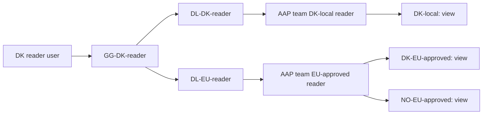

# Demo guide: AD groups mapped to AAP teams

Presenter walkthrough, 15-20 minutes. Screens: the domain controller (VNC or
remote console) and the AD AAP in a browser (one admin window, one private
window for the AD test user). The demo reads configuration and runs inert
mock jobs; part 2 adds an AD user from AAP.

Names below use `<prefix>` for the deployment prefix; the real prefix,
usernames and the shared demo-user password are in the private repository.

## 1. The story

> "People and their regional group memberships live in Active Directory.
> When someone signs in, AAP checks AD and puts them into the matching AAP
> teams. The teams hold the permissions on the country's local resources or
> on its EU-approved resources, at reader, executor or admin level."

| Term | Meaning in this demo |
| --- | --- |
| LDAPS | LDAP over TLS (port 636); AAP authenticates users and reads groups |
| GG group | global group = people (one per country and role) |
| DL group | domain-local group = access (one per access scope and role) |
| AAP team | holds object-scoped roles on the resource sets |
| Mapping | membership in a DL group -> membership in an AAP team |

Access matrix (role = reader: view; executor: view + use/execute, projects
view only; admin: administer the scoped resources):

| Cohort | DK-local | NO-local | DK-EU-approved | NO-EU-approved | NZ-local |
| --- | --- | --- | --- | --- | --- |
| DK | yes | - | yes | yes | - |
| NO | - | yes | yes | yes | - |
| HU | - | - | yes | yes | - |
| NZ | - | - | - | - | yes |

AD holds who belongs to which group; AAP holds the permissions; the AAP
configuration (applied by Ansible) connects the two. AD ACLs are not imported.

## 2. Preparation

1. Sign in on the domain controller as domain administrator.
2. Sign in to the AD AAP as local admin (admin window).
3. Open a private browser window for the AD test users.
4. Check that the five projects synced and launch **Active Directory - Smoke
   Test** (DK reader and NZ executor see exactly their job templates).

## 3. Windows: the user and its groups

1. Open **Active Directory Users and Computers** (`dsa.msc`).
2. Expand `<prefix>` -> **DK**, open `<prefix>-dk-reader` -> **Member Of**:
   `<prefix>-GG-DK-reader` (direct membership only).
3. Open `<prefix>-GG-DK-reader` -> **Member Of**: `<prefix>-DL-DK-reader` and
   `<prefix>-DL-EU-reader`.
4. In OU **EU**, open `<prefix>-DL-EU-reader` -> **Members**: the DK, NO and
   HU reader global groups; NZ is absent.

> "Denmark, Norway and Hungary readers inherit access to both EU-approved
> sets. Each country keeps its own local access. New Zealand is separate."

## 4. AAP: authenticator and mappings

1. **Access Management -> Authentication Methods** -> `<prefix> Active
   Directory`: type LDAP, URI `ldaps://...:636`, group type
   `NestedActiveDirectoryGroupType` (follows the nesting from step 3).
2. Tab **Mapping**: twelve team mappings (4 scopes x 3 roles), plus the login
   and organization mappings. Open `DK reader membership`: team
   `<prefix> DK-local reader`, trigger = DN of `<prefix>-DL-DK-reader`
   (lowercase), revoke enabled.
3. **Teams** -> `<prefix> DK-local reader` -> **Roles**: project, inventory,
   credential and both job templates of `DK-local`, view only.
   `<prefix> EU-approved reader`: the same for both EU-approved sets.

## 5. Log in as the AD user

1. Private window: sign in as `<prefix>-dk-reader` with the demo password.
2. Admin window: **Users** -> that user -> **Teams**: exactly
   `DK-local reader` and `EU-approved reader`.
3. Private window: inventories, templates, credentials and projects of
   DK-local, DK-EU-approved and NO-EU-approved are visible; NO-local and
   NZ-local are absent; no launch or edit.

## 6. Contrasts (optional)

| AD user | Show |
| --- | --- |
| DK executor | launch `DK-local Read` -> Successful; no edit |
| DK admin | **Edit** on an allowed resource, then Cancel |
| HU executor | only the two EU-approved sets; launch `NO-EU-approved Simulate Change` |
| NZ reader | only NZ-local |

The mock job templates only print and report a simulated change; nothing is
patched or changed.

## 7. Part 2: administer AD from AAP

1. Admin window: launch **Active Directory - Add User**; survey: user name
   (for example `<prefix>-dk-reader2`), country `DK`, role `reader`.
2. The job creates the user with the native `microsoft.ad.user` module in OU
   `DK`, adds it to `<prefix>-GG-DK-reader` and gives it the shared demo
   password.
3. Show the user in `dsa.msc`, then sign in with it in the private window:
   same access as the DK reader, no AAP user or team created by hand.

Membership changes take effect at the next sign-in.

## Troubleshooting

| Symptom | Check |
| --- | --- |
| LDAP login fails | username (short name), authenticator enabled, domain time, DNS, LDAPS certificate (signed by the AutoDeploy CA) |
| Login works, teams missing | mapping trigger DNs (lowercase), nested group type; sign out and in again |
| Resource missing or too visible | the team's roles against the matrix above; do not add broad roles |
